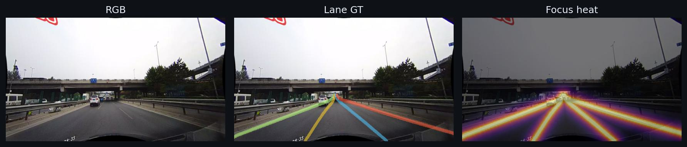
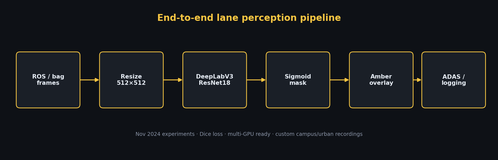
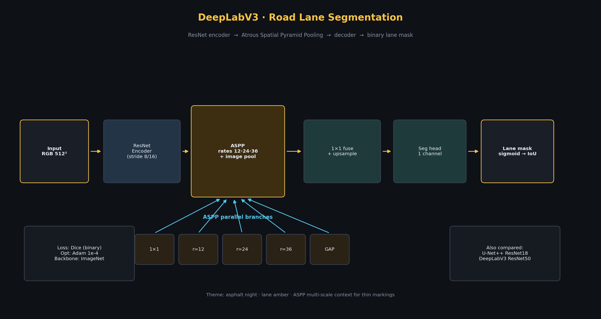
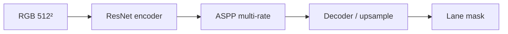
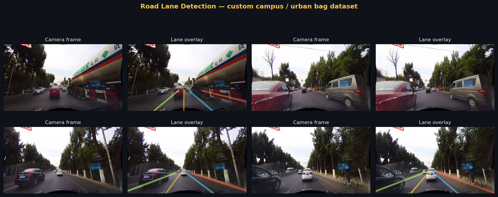
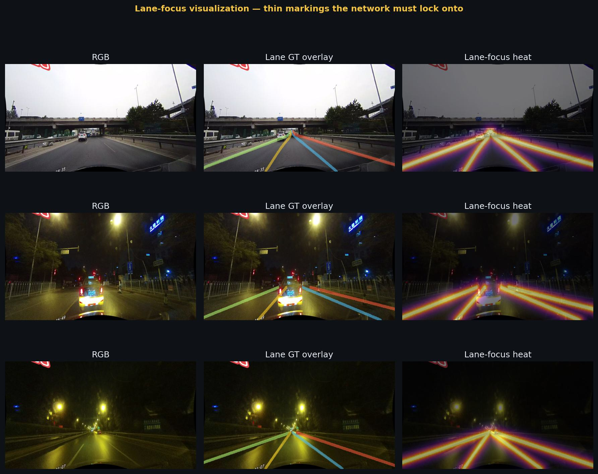

<h1 align="center">Road Lane Detection</h1>

<p align="center">
  <strong>Binary lane-marking segmentation for campus &amp; urban ego-camera video.</strong><br>
  DeepLabV3 / U-Net++ · custom bag-extracted dataset · late <b>2024</b>
</p>

<p align="center">
  
  
  
  
  
  
</p>

<p align="center">
  
</p>
<p align="center"><em>Thin lane paint is easy for humans, hard for CNNs — this project locks onto those pixels.</em></p>

---

## Overview

> **Timeline:** Built in **late 2024** (bag capture Oct 2024 · training / W&B Nov 2024).  
> Face Mask (2020) → Crop & Weed (2023) → **Road Lane (2024)** → Pin-point (2026).

Ego-camera frames from campus / urban drives are labeled in a CULane-style scheme and trained as **binary lane vs background** with Dice loss.

| Piece | Choice |
|-------|--------|
| Primary model | **DeepLabV3 + ResNet18** (ImageNet encoder) |
| Also compared | DeepLabV3-ResNet50 · U-Net++ ResNet18 |
| Input | RGB `512×512` |
| Loss | Dice (binary) |
| Opt | Adam `1e-4` |
| Data | ~18k train frames · custom sequences from ROS bags |

---

## Pipeline

<p align="center">
  
</p>

```text
ROS bag → frames → DeepLabV3 → sigmoid mask → amber overlay → ADAS / logging
```

---

## Architecture — DeepLabV3

<p align="center">
  
</p>

### Why DeepLabV3 for lanes?

Lane paint is **thin, long, and multi-scale** (near-field thick strokes → far-field hairlines). Atrous Spatial Pyramid Pooling (**ASPP**) probes several dilation rates so the head sees both local edge contrast and road-level context without crushing resolution the way aggressive pooling would.

| Block | Role |
|-------|------|
| ResNet encoder | Hierarchical features (ImageNet warm-start) |
| ASPP (`r=12,24,36` + GAP) | Multi-scale lane context |
| 1×1 fuse + upsample | Restore spatial detail |
| 1-channel head + sigmoid | Binary lane probability map |



Compare with a plain U-Net: skips help edges, but ASPP is especially strong when lane width changes drastically with depth.

---

## Visual results

### Dataset — RGB vs lane overlays

<p align="center">
  
</p>

### Lane-focus heat

<p align="center">
  
</p>
<p align="center"><em>Annotation-guided focus maps show the sparse pixels that matter. For true Grad-CAM, run <code>gradcam.py</code> with a checkpoint.</em></p>

---

## Project structure

```text
.
├── dataset.py          # LaneDataset (binary / multi-id aware)
├── models.py           # DeepLabV3 · U-Net++ · U-Net factory
├── train.py            # Dice training + curves
├── evaluate.py         # IoU + RGB/GT/pred panels
├── infer.py            # Image / folder inference
├── gradcam.py          # Seg-Grad-CAM explainability
├── utils.py
├── scripts/render_architecture.py
├── data/README.md
└── assets/             # README visuals
```

---

## Quick start

```bash
git clone https://github.com/Sandesh1764/road-lane-detection.git
cd road-lane-detection
python -m venv .venv && source .venv/bin/activate
pip install -r requirements.txt
```

Place data as in [`data/README.md`](data/README.md), then:

```bash
# Train
python train.py --data-root dataset --architecture deeplabv3 --encoder resnet18 --epochs 50

# Evaluate
python evaluate.py --checkpoint outputs/checkpoints/best.pth --data-root dataset/train

# Infer
python infer.py --checkpoint outputs/checkpoints/best.pth --input path/to/frame.jpg

# Grad-CAM
python gradcam.py --checkpoint outputs/checkpoints/best.pth --input path/to/frame.jpg
```

---

## Notes

- Full `dataset/`, W&B runs, and `.pth` weights are **gitignored**.
- Legacy experiment scripts live locally under `extra/` (not published).
- Architecture art: `python scripts/render_architecture.py`

---

## Acknowledgements

- [segmentation_models_pytorch](https://github.com/qubvel/segmentation_models.pytorch)
- DeepLabV3 — [Chen et al.](https://arxiv.org/abs/1706.05587)
- Grad-CAM — [Selvaraju et al.](https://arxiv.org/abs/1610.02391)

## License

MIT — see [LICENSE](LICENSE).
